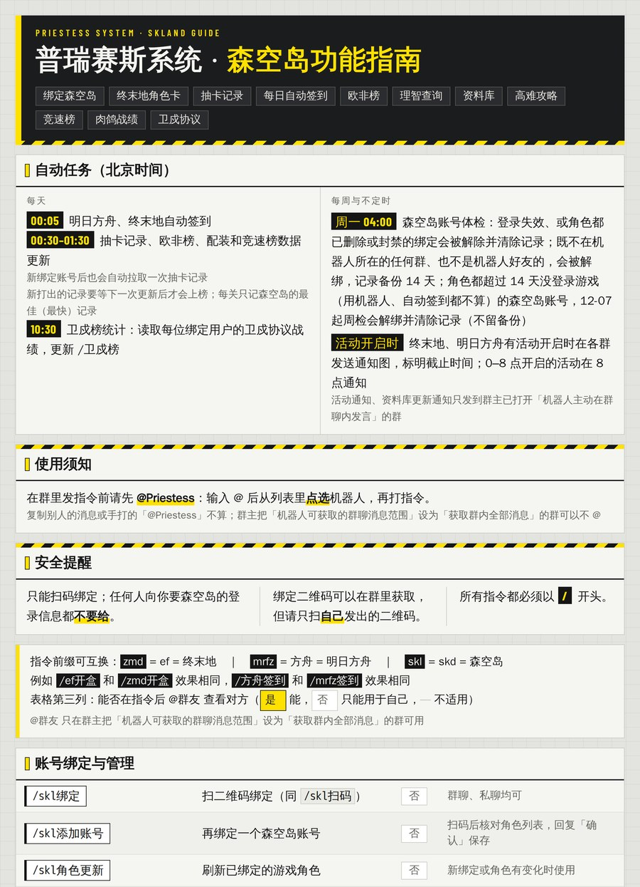
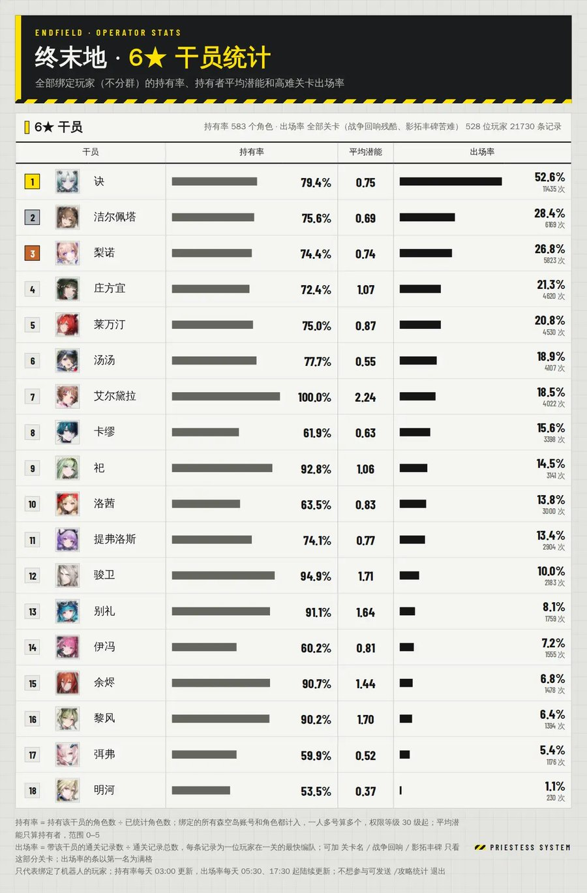
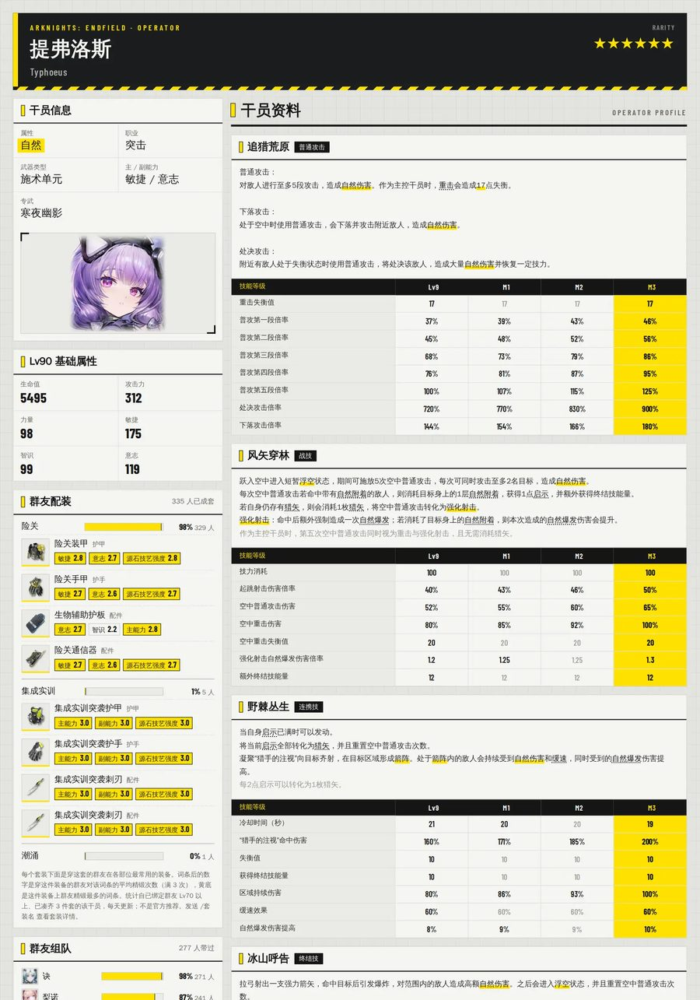

# Priestess QQbot

A QQ group bot for Arknights: Endfield and Arknights players, running as a QQ official bot on NoneBot2.


这是我给《明日方舟：终末地》和《明日方舟》玩家群做的 QQ 群机器人。我自己的机器人用的就是这份代码，线上有改动我会同步过来。

它是一个 QQ 官方机器人：NoneBot2 加 nonebot-adapter-qq，`plugins/official_bridge` 把官方平台的事件转成 OneBot v11，其他插件照常工作。
森空岛绑定、签到、角色卡这些基础功能来自 [nonebot-plugin-skland](https://github.com/FrostN0v0/nonebot-plugin-skland)，
我在上面加了终末地资料库、高难关卡资料和榜单、两款游戏的抽卡记录同步、干员统计、账号体检，以及统一风格的出图。
上游插件的安装包不做修改，我的改动都在 `plugins/` 里。

机器人拉进群以后，群主需要改两项设置：打开「机器人主动在群聊内发言」，不然收不到推送；「机器人可获取的群聊消息范围」设成「获取群内全部消息」，
不然发指令都得 @ 机器人。见 [群主需要做的](docs/deploy-official.md#群主需要做的)。

这个仓库只维护官方机器人这一种用法。想用 NapCat 的，请用旧仓库 [Priestess-bot](https://github.com/Billtranscend/Priestess-bot/tree/napcat-final) 的 `napcat-final`。

## 目录

- [功能](#功能)
- [截图](#截图)
- [部署](#部署)
- [运行环境](#运行环境)
- [配置](#配置)
- [指令](#指令)
- [管理指令](#管理指令)
- [定时任务](#定时任务)
- [更新与重启](#更新与重启)
- [数据与隐私](#数据与隐私)
- [常见问题](#常见问题)
- [反馈](#反馈)
- [致谢](#致谢)
- [免责声明](#免责声明)
- [许可证](#许可证)

## 功能

### 账号与签到

- 扫码绑定森空岛，不支持凭据绑定。一个 QQ 可以绑好几个森空岛账号，默认角色随时能换，也能临时查看另一个角色。
- 每天自动签到明日方舟和终末地，绑定的账号和角色都签。刚绑定或新加账号时马上签一次、读一次卫戍榜成绩，
  两款游戏的抽卡记录拉完后告诉你结果：二维码私聊发给你的，结果也私聊发；否则回复你绑定时发的那条消息。
- 绑定保护：在群里发 `/skl绑定`，你是机器人好友的话，二维码私聊发给你，群里只说一句；还不是好友的，二维码照旧发在群里，
  也只认发指令的本人。一个森空岛账号只能绑在一个 QQ 上，重新扫码续期要用原来那个 QQ。
- 每周一体检：登录已失效、全部角色都签不了到的绑定会被解除，删之前先备份。

### 终末地

- 角色卡（开盒）：账号概况、据点和全部干员的练度。
- 抽卡记录：绑定后和每天自动同步，存下来就不受官方保留期限的影响。赠送和免费十连单独标出，不算抽数。
  限定寻访、辉光庆典、重构寻访都算限定池。
- 小黑盒导入：补回官方接口已经查不到的早期记录，一条 `/导入小黑盒` 两款游戏一起导。只认和绑定 UID 相同的小黑盒账号，官方的记录不会被改动。
- 欧非榜：全部绑定用户一起排，不分群。干员统计：全部绑定角色的 6★ 持有率、平均潜能和高难出场率。
- 资料库：干员、武器、装备套装和散件的资料卡，认昵称、简称和同音字，带技能数值表、后勤技能，
  还有已绑定成员的配装和组队统计，只给汇总。数据来自 AKEData，有新数据时自动重建。
  新增干员或武器时在群里通知，重建失败或资料卡缺内容时私聊告诉超级用户。
- 高难关卡（战争回响、影拓丰碑）：和游戏里顺序一致的关卡一览、关卡机制、算上关卡加成的敌人数值和抗性，以及群内竞速榜。

### 明日方舟

- 角色卡（开盒）：账号概况、助战、基建和全部干员的练度，用明日方舟自己的界面风格。
- 抽卡记录：同样每天自动同步，按卡池开放的年份分页，用按钮翻页。
- 小黑盒导入：和终末地用同一条指令。
- 卫戍协议战绩，以及全部绑定用户的奖杯榜。
- 干员一览、集成战略战绩，来自上游插件。

### 群里的其他功能

- 活动日历：两款游戏正在开放和快要开始的活动、卡池和截止时间。有活动开启时往各群发一张通知图，不 @全体；
  0 点到 8 点开启的，8 点统一发。
- 本周任务：两款游戏的周常一张图，发 `/本周任务` 时生成。
- 理智：`/理智` 看两款游戏当前的理智，以及多久回满。
- 快捷按钮：菜单类的回复下面带按钮，点一下就等于你自己 @ 机器人发了那条指令，见 [快捷按钮](docs/deploy-official.md#快捷按钮)。
- 有人加机器人为好友时，发一句欢迎语，下面带三个点一下就能发的指令。机器人被拉进群时，在群里说明一次群主可以打开的两项设置。

### 使用约定

- 所有指令都以 `/` 开头，严格匹配，聊天内容不会误触发。指令末尾多打的空格不影响。
- 群里发指令要真正 @ 机器人：输入 @ 之后从列表里点选。群主把「机器人可获取的群聊消息范围」设成「获取群内全部消息」的群，可以不 @。
- 榜单、统计和理智按每个人的默认角色算，随时可以退出统计。例外是干员统计的持有率，它算所有绑定的账号和角色；
  还有卫戍榜，它取奖杯最多的那个明日方舟角色。
- 平台不支持合并转发卡片。好几页的结果逐张发图，文字页合成尽量少的几条消息。
- 菜单和按钮消息在提问的人做了选择、回答发出后撤回；群里没人理的，90 秒后撤回。

## 截图

| 帮助 | 干员统计 |
|---|---|
|  |  |

| 干员资料 |
|---|
|  |

## 部署

部署成 QQ 官方机器人的步骤见 [部署](docs/deploy-official.md)。要先在 QQ 开放平台注册一个机器人，不需要 Docker。
从零部署这条路我自己没有完整走过一遍，遇到问题到 [Issues](https://github.com/Billtranscend/Priestess-QQbot/issues) 告诉我。

| 情况 | 看哪里 |
|---|---|
| 第一次部署 | [部署](docs/deploy-official.md) |
| 已经按 NapCat 版部署过，想把数据带过来 | [从 NapCat 版迁移](docs/migrate-to-official.md) |
| 想同时用 nonebot-bison 推送 B 站动态 | [搭配 nonebot-bison](docs/deploy-official.md#搭配-nonebot-bison) |
| 想改代码或了解结构 | [开发说明](docs/development.md) |

## 运行环境

| 项目 | 我在用的环境 | 说明 |
|---|---|---|
| 操作系统 | Ubuntu 24.04 LTS | 其他带 systemd 的 Linux 发行版应该也行 |
| CPU 架构 | aarch64（ARM64） | 长期跑在一台 2 核 / 12 GB 的 ARM 云服务器上；x86_64 我没试过 |
| Python | 3.12 | 只在 3.12 上跑过，建议用同一个版本 |
| Python 依赖 | `requirements.txt`、`requirements-official.txt`，加约束文件 `requirements.lock` | 锁定文件是线上机器人正在用的全部包版本 |
| 无头浏览器 | Playwright 1.62.0 的 Chromium | 出图用。装完 Python 依赖后要单独装一次，连同系统库，见部署页 |
| 内存 | 2 GB 以上 | 出图用的是无头 Chromium |
| 中文字体 | 文泉驿正黑（`fonts-wqy-zenhei`） | 图里的中文字体；数字和英文用仓库自带的 Barlow Condensed |
| 公网 IP | 固定的 | QQ 开放平台按 IP 白名单放行 |
| 网络 | 能访问 QQ 开放平台、森空岛和鹰角网络（`skland.com`、`hypergryph.com`、`hycdn.cn`）、AKEData、PRTS Wiki、GitHub；小黑盒导入时还要访问小黑盒 | 明日方舟的数据资源从 GitHub 下载，全新部署第一次启动时的终末地卡池表也是。安装时还要访问 PyPI 和 Playwright 的浏览器下载地址 |

Windows 和 macOS 没试过：systemd 单元、字体的装法和一部分路径都是按 Linux 写的。

## 配置

配置写在 `.env` 和 `.env.prod`，从 `.env.example` 复制，不要提交。每一项的意思见部署页的 [配置](docs/deploy-official.md#配置)。

两件和时区有关的事：

- 定时任务用 `nonebot-plugin-apscheduler` 的时区 Asia/Shanghai，和服务器的系统时区无关。
- 上游 nonebot-plugin-skland 用进程本地时间格式化日期，比如苏醒日、抽卡记录的日期、4 点刷新的倒计时。
  服务器不在东八区时，给机器人进程设 `TZ=Asia/Shanghai`，示例 systemd 单元里已经有了。不设的话，北京时间 0 点到 8 点之间的日期会早一天。

## 指令

所有指令都以 `/` 开头。「可 @他人」表示可以在指令后面 @ 群友，查看对方的数据。
在指令里 @ 别人，要群主把「机器人可获取的群聊消息范围」设成「获取群内全部消息」。

指令前缀可以互换：`zmd` = `ef` = `终末地`，`mrfz` = `方舟` = `明日方舟`，`skl` = `skd` = `森空岛`，比如 `/ef开盒` 和 `/zmd开盒` 一样。`/方舟干员` 只有这一种写法。

### 账号

| 指令 | 作用 | 备注 |
|---|---|---|
| `/skl绑定` | 扫二维码绑定森空岛，同 `/skl扫码` | 群聊、私聊都行；在群里发、又是机器人好友时，二维码私聊发给你。只能扫码，上游的凭据绑定已经关掉了 |
| `/skl添加账号` | 再绑一个森空岛账号 | 二维码同 `/skl绑定`；扫码后核对角色列表，回复「确认」保存 |
| `/skl角色更新` | 刷新已绑定的游戏角色 | |
| `/skl角色` | 查看已绑定的账号、角色和序号 | 标着「插件默认」的是指令默认用的角色 |
| `/skl切换终末地角色 序号` | 换默认角色 | 方舟用 `/skl切换方舟角色 序号`；不带序号时给出角色按钮 |
| `/导入小黑盒 小黑盒ID` | 从小黑盒补回终末地和明日方舟更早的抽卡记录，一次两款都导 | 只能导入和自己绑定的 UID 相同的小黑盒账号；小黑盒里没有哪款游戏的数据就跳过哪款 |
| `指令 角色序号` | 临时查看另一个角色，不改默认角色 | 例如 `/zmd抽卡记录 角色2`、`/zmd开盒 角色2`、`/卫 角色2`。序号见 `/skl角色` |
| `/skl解绑` | 解绑，并删掉角色和抽卡记录 | 先选账号序号或「全部」，再回复「确认」 |

群友手打的上游原始写法 `/sk`、`/skland`，以及依赖插件的 `/user`、`/bind`、`/argot` 都不回应，每个功能都用上面这些中文指令。

### 终末地

| 指令 | 作用 | 可 @他人 |
|---|---|---|
| `/zmd开盒` | 终末地角色卡：账号概况、据点，全部干员的武器、技能等级和装备 | 是 |
| `/zmd签到`、`/zmd签到详情` | 手动签到 / 查看签到状态 | 否 |
| `/签到详情` | 自己在两款游戏的签到状态 | 否 |
| `/zmd抽卡记录` | 查看抽卡记录：先给出卡池类型的按钮，点了哪一类出哪一类的图 | 否 |
| `/zmd抽卡记录 限定池\|武器池\|其他卡池` | 直接看某一类卡池 | 否 |
| `/zmd抽卡记录更新` | 马上拉取抽卡记录，并说明新增了几条 | 否 |
| `/干员统计 [范围]` | 6★ 干员一张表：持有率、持有者的平均潜能、高难出场率。持有率算权限等级 30 级起的全部绑定角色，一人多号算多个。人人开局就有的干员「管理员」不列入。范围可以写关卡名、`战争回响`、`影拓丰碑`，只影响出场率 | 否 |
| `/zmd欧非榜`（也可发 `/欧非榜`） | 全部绑定用户的角色池、武器池欧非榜前 10 和后 10 名，不分群，群聊、私聊都行。按欧气排：（榜上所有人的平均 − 他的平均）× √UP 数 ÷ 正常波动，至少 4 个 UP 才上榜，图上写着算法和这次用到的数字。查的人自己那一行写着名次，以及比榜上百分之多少的人欧。本群成员显示群名片并标「本群」，其他人显示游戏里的角色名。`/zmd欧非榜 退出` 可以不上榜 | 否 |
| `/角色欧非榜`、`/武器欧非榜` | 角色池 / 武器池的完整欧非榜，不分群。超过 300 人时只列前 150 名和后 150 名 | 否 |

### 终末地资料库

| 指令 | 作用 |
|---|---|
| `/干员名` | 干员资料卡，认昵称和同音字，例如 `/提丰`、`/小庄`。卡里有群友的配装统计 |
| `/干员名专武` | 这个干员专属武器的资料卡 |
| `/武器名` | 武器资料卡，认简称 |
| `/套装名`、`/装备名` | 装备套装资料卡：3 件套效果、各件装备未精锻和精锻满级的属性、成员使用统计，例如 `/险关`、`/潮涌手甲`。散件按系列出卡，例如 `/涉渊护手` |

### 活动日历与周常

| 指令 | 作用 |
|---|---|
| `/zmd活动`（也可发 `/终末地活动`、`/zmd日历` 等） | 终末地正在开放和快要开始的活动、卡池和截止时间 |
| `/mrfz活动`（也可发 `/明日方舟活动`、`/粥活动`、`/舟日历` 等） | 明日方舟，同上 |
| `/活动`、`/日历` | 先选游戏，或者选「一起看」 |
| `/全部活动` | 两款游戏各一张 |
| `/本周任务`（也可发 `/每周任务`、`/周常任务`） | 两款游戏的周常：方舟剿灭（本期轮换）、周常任务、保全派驻，终末地每周事务、通行证周常 |

游戏名和「活动 / 日历 / 活动日历 / 活动列表」之间可以有空格或者「的」。时间都是北京时间。

### 高难关卡

| 指令 | 作用 |
|---|---|
| `/战争回响` | 本期轮换的关卡、封面和剩余时间 |
| `/影拓丰碑 [丰碑名]` | 全部丰碑的封面和关卡序号；带丰碑名时显示这个丰碑各关的封面 |
| `/敌人 领袖敌人名` | 领袖敌人的特性和各级默认属性，从危境挑战一级起；`/敌人 领袖` 是目录 |
| `/敌人 关卡名或丰碑名 [序号] [难度]` | 关卡机制和敌人属性，战争回响附增辉条件。`/回响敌人` 看本期轮换，`/丰碑敌人` 看当前丰碑 |
| `/竞速榜` | 竞速榜目录 |
| `/竞速更新` | 马上拉取自己的战争回响和影拓丰碑记录并更新榜单，每人每 5 分钟一次 |
| `/回响竞速 [关卡名]` | 战争回响本群最快通关排名 |
| `/丰碑竞速 [丰碑名或关卡名]` | 影拓丰碑本群最快通关排名 |
| `/攻略统计 退出` / `加入` | 退出或重新加入组队、干员统计和榜单 |

### 明日方舟与其他

| 指令 | 作用 |
|---|---|
| `/mrfz开盒 [@用户]` | 明日方舟角色卡：账号概况、助战、基建和全部干员的练度。也可发 `/mrfz卡片`、`/mrfz查询` |
| `/卫 [@用户]`（也可发 `/卫戍战绩`、`/mrfz卫戍`） | 卫戍协议战绩：奖杯、场次、Boss 击杀、完成率、游戏时长、常用策略和盟约、六维评价和称号、最近对局。后面加 `全部` 看全部对局，查自己时一次一页、用按钮翻页，`第2页` 直接看某一页；`收藏` 看收藏的对局；`详情` 列出各局；加数字看单局详情，例如 `/卫 3`。数据和统计来自 nonebot-plugin-skland，图按我的明日方舟风格画。官方数据每天 10:00 刷新 |
| `/卫戍榜` | 卫戍协议奖杯榜，赛季名取自森空岛，每天 10:30 刷新。列前 20 名，查榜的人不在其中时另外写出他的名次。全部绑定用户，不分群；本群成员显示群名片并标「本群」，其他人显示游戏里的名字。`/卫戍榜 更新` 只重读自己的成绩，5 分钟一次；`/卫戍榜 退出` / `加入` 控制是否上榜 |
| `/mrfz签到`、`/mrfz签到详情` | 明日方舟签到 |
| `/mrfz抽卡记录` | 查看抽卡记录：按卡池开放的年份分页，一年里卡池太多时再按月份，先发最新的一页，用按钮翻页 |
| `/mrfz抽卡记录 第N页` | 直接看第 N 页，第 1 页最新 |
| `/mrfz抽卡记录更新` | 马上拉取抽卡记录，并说明新增了几条 |
| `/方舟干员 [筛选词]` | 干员一览 |
| `/树海肉鸽 [@用户]` | 集成战略战绩（黑流树海）。其他主题发 `/界园肉鸽`、`/萨卡兹肉鸽`、`/萨米肉鸽`、`/水月肉鸽`、`/傀影肉鸽` |
| `/战绩详情 ID` | 单局肉鸽战绩：引用机器人刚发的肉鸽战绩图发这条指令，ID 是图上对局的编号。收藏的对局用 `/收藏战绩详情 ID` |
| `/理智` | 查看方舟和终末地当前的理智 |
| `/抽卡记录` | 问你看哪一款游戏的抽卡记录 |
| `/skl帮助`（也可发 `/帮助`、`/help`） | 先给出各分类的按钮，「完整帮助图」按钮发帮助图；`/帮助 分类名` 看某一类指令的文字版，例如 `/帮助 终末地` |

## 管理指令

只有 `SUPERUSERS` 里的人能用，其他人发了不起作用。

| 指令 | 作用 |
|---|---|
| `/森空岛体检` | 检查全部绑定，只报告，不改动 |
| `/森空岛体检 清理` | 检查并解除失效的绑定，删之前先写备份 |
| `/攻略数据更新` | 马上收集高难关卡战绩 |
| `/资料库更新` | 马上重建终末地资料库 |
| `/资源更新` | 马上更新明日方舟数据资源和终末地卡池表。平时每天 09:00 自动更新 |
| `/小黑盒登录` | 私聊发：扫码登录机器人读明日方舟小黑盒数据用的账号。之后每天 6:10、18:10 自动续期，续不上时私聊提醒你 |
| `/活动通知预览` | 预览活动开启通知图 |
| `/全体签到`、`/全体签到详情` | 马上给两款游戏的全部绑定角色签到 / 查看结果 |
| `/skl全体角色更新` | 刷新全部绑定账号的角色 |
| `/卫戍榜 刷新` | 马上统计一次卫戍榜 |
| `/群检查` | 马上查一遍各群的群名，清掉已解散的群。平时每天 0 点自动查 |

超级用户还会私聊收到这些：账号体检有改动、出错或跳过某一项时的报告，资料库同步失败或资料卡缺内容的提醒，小黑盒登录失效或快到期的提醒。
所以超级用户要先加机器人为好友。

## 定时任务

时间都是北京时间。

| 时间 | 任务 | 来源 |
|---|---|---|
| 每天 00:00 | 查一遍各群的群名，清掉已解散的群 | `official_bridge` |
| 每天 00:15 / 00:20 | 明日方舟 / 终末地自动签到，5 个账号同时签 | nonebot-plugin-skland、`skland_health` |
| 每天 01:00 | 两款游戏的抽卡记录自动同步，新绑定的账号也会马上排进队列。终末地每次只拉新记录，每人每周完整核对一次 | `skland_auto_gacha`、`skland_ark_gacha` |
| 每天 03:00 | 收集成员的配装和持有干员，给配装统计和干员统计的持有率用 | `endfield_guide` |
| 每天 04:30 | 欧非榜全员重算。什么算 UP 取决于卡池表，卡池表会随游戏更新变化 | `skland_gacha_rank` |
| 每天 05:30、17:30 | 收集高难关卡战绩，竞速榜、出场率、组队统计陆续更新 | `endfield_guide` |
| 每天 06:10、18:10 | 续期小黑盒登录，用 `/小黑盒登录` 登录过才运行。没续上隔 10 分钟再试，每轮最多 3 次 | `heybox_import` |
| 每天 09:00 | 更新明日方舟数据资源和终末地卡池表 | nonebot-plugin-skland、`skland_ef_pools` |
| 每天 10:30 | 卫戍榜统计：用每个成员自己的森空岛登录，读他每个明日方舟角色的战绩，奖杯最多的角色上榜，5 个成员同时读。没打过的角色不上榜，一个角色也没读到的沿用上一次的数字 | `arknights_garrison` |
| 每 10 分钟 | 检查 AKEData 的数据版本，有新版本马上重建资料库；新增了干员或武器时通知各群，不分时段 | `endfield_wiki` |
| 每 10 分钟 | 资料库重建后刷新终末地卡池表，补取缺少的卡池横幅 | `skland_ef_pools` |
| 每 5 分钟 | 检查两款游戏有没有活动开启，有就往各群发通知图，0 点到 8 点开启的 8 点发 | `game_calendar` |
| 每 30 分钟 | 检查明日方舟的游戏数据版本；每小时查一次 PRTS Wiki 登记的活动 | `game_calendar` |
| 每 6 小时 | 预先下载明日方舟干员的立绘、头像等图片 | `skland_ark_assets` |
| 每周一 04:00 | 森空岛账号体检，见下面 | `skland_health` |

推送只发到群主打开了「机器人主动在群聊内发言」的群。

账号体检会解除这些绑定，每删一个都先追加进备份，见 [数据与隐私](#数据与隐私)：

- 登录已失效的。要森空岛明确答复过期才算，限流、繁忙这类回答等下周再查。
- 全部角色都签不了到的。角色要隔一周再被拒一次才删。
- 本人既不在机器人任何群里、也不是机器人好友的。这一项要等原来的 NapCat 账号退出所有群才开始，所以只在和 NapCat 并存过的部署上有。超级用户不受影响。
  从零部署的机器人上会跳过这一项。跳过时，体检报告里有一行『群成员名单或好友列表没能完整读取：本次没有按「已退群」解除任何账号』，
  超级用户每周一都会因此私聊收到这份报告，日志里还有一条 `official bridge: get_group_list failed` 的警告。这是正常的，不用处理。

## 更新与重启

更新代码的步骤：

```bash
cd /opt/priestess-qqbot
sudo systemctl stop nonebot
cp -a data/nonebot_plugin_orm/db.sqlite3 ~/db-before-update.sqlite3   # 先备份数据库
git pull
.venv/bin/pip install -r requirements.txt -r requirements-official.txt -c requirements.lock
.venv/bin/python deploy/orm_cli.py upgrade
sudo systemctl start nonebot
```

`requirements.lock` 跟着线上机器人更新，安装时一直带着 `-c requirements.lock`，不要单独升级其中的包。
锁定文件里 `playwright` 的版本变了的话，再运行一次 `.venv/bin/playwright install chromium`，用装浏览器的那个用户。

只改了插件代码、依赖和数据库都没变时，可以用 `.venv/bin/python deploy/restart_when_idle.py` 重启。
它会等到没有指令在处理，也没有战绩收集、卫戍榜统计、账号体检或夜间签到在进行，才重启，免得打断群友。
这个脚本只认 `nonebot.service` 这个服务名，还要当前用户能免密码执行 `sudo`。

没和 NapCat 并存过的机器人每次启动后，头 3 分钟里定时推送、给超级用户的私聊、绑定后抽卡记录拉完的那条回复都发不出去，Bison 也还没接上，指令照常能用。

自己改代码的话，注意仓库不带测试，也没有任何自动检查，改动要自己验证。结构见 [开发说明](docs/development.md)。

## 数据与隐私

- `data/` 里的数据库存着用户的森空岛凭证，`.env.prod` 里有机器人的 AppSecret。这些都已经在 `.gitignore` 里排除，不要提交或公开，
  目录权限保持只有自己能读。
- `data/official_bridge/idmap.sqlite3` 记着平台标识和编号的对应。它丢了，所有人的编号都会重新分配，要和数据库一起备份。
- 账号体检每删一个账号或角色，都先把删掉的行追加进这次运行的备份 `backups/skland-health/<UTC 时间>.jsonl`。
  一行是一次删除，含账号、角色和抽卡记录。里面有登录凭证，目录权限 700，文件 600。运行中途出错也不会丢。
  要把备份写回数据库，先停掉机器人，然后：

  ```bash
  # 只核对、报数，什么都不写
  .venv/bin/python deploy/restore_health_backup.py backups/skland-health/<备份文件>.jsonl data/nonebot_plugin_orm/db.sqlite3
  # 写回；有任何冲突就一行都不写
  .venv/bin/python deploy/restore_health_backup.py backups/skland-health/<备份文件>.jsonl data/nonebot_plugin_orm/db.sqlite3 --apply
  ```

  加 `--apply` 之前，先看列出的成员该不该回来：之后自己解绑过的人，也会连同凭证被写回。写回后再启动机器人，
  启动时会给这些成员补上默认角色。
- 小黑盒导入只在用户本人发出指令时，读他小黑盒的「抽卡分析」页面，并在 `data/heybox_import/` 留一份原始响应，方便追查。
  终末地读的是公开数据。明日方舟的只对登录了的小黑盒账号开放，所以机器人存着一个专用小黑盒账号的登录状态，
  在 `data/heybox_import/login/`，和森空岛凭证一样不要公开。由超级用户私聊 `/小黑盒登录` 扫码一次，之后每天自动续期。
  小黑盒只存汇总数据：导入的记录里，六星和它的抽数是准确的，明日方舟的五星也是，其余用占位记录补足数量。
- 竞速榜和干员统计只用已绑定用户的最佳通关记录和持有干员，配装、组队和持有率只显示汇总。用户可以用 `/攻略统计 退出`、`/zmd欧非榜 退出` 退出统计。
- 欧非榜不分群，会给其他群的人看到上榜者游戏里的角色名，群名片只在本群显示。不想上榜可以发 `/zmd欧非榜 退出`。
- 卫戍榜也不分群。不想上榜可以发 `/卫戍榜 退出`。
- 机器人日志不记聊天内容（`plugins/log_privacy`），但会有成员和群的编号。分享日志前自己处理一下。
  systemd 日志的保留时间按需要设，比如 `MaxRetentionSec=30day`。

## 常见问题

**第一次启动报 `Playwright environment is not set up correctly`，起不来。** 出图用的浏览器没装好。
照 [部署](docs/deploy-official.md#部署步骤) 第 3 步，装完 Python 依赖后单独装：`sudo .venv/bin/playwright install-deps chromium`，
再 `.venv/bin/playwright install chromium`。浏览器装在执行安装的那个用户的 `~/.cache/ms-playwright` 下，systemd 服务要用同一个用户运行，
或者安装时和服务里设同一个 `PLAYWRIGHT_BROWSERS_PATH`。

**群里发指令没有反应、收不到推送、管理指令没反应。** 见部署页的 [常见问题](docs/deploy-official.md#常见问题)。

**出图很慢。** 一张图通常要 5 到 20 秒，别重复发同一条指令。
清晰度和体积在哪里调，见 [开发说明](docs/development.md#图片清晰度与体积)。

**升级了某个依赖之后起不来。** 按 `requirements.txt`、`requirements-official.txt` 加 `-c requirements.lock` 装，不要单独升级。
nonebot-plugin-skland 在启动时会被校验，见 [开发说明](docs/development.md#上游插件的校验)。这是故意的，免得本地补丁在上游改了之后悄悄失效。

**图里的中文显示成方块。** 装上 `fonts-wqy-zenhei`，然后重启。

**活动、卡池或下期轮换没有显示。** 终末地的数据来自 AKEData 的解包，明日方舟的来自 ArknightsGameResource 和 PRTS Wiki。游戏更新后这些数据可能晚一阵才有，以游戏里的公告为准。

**机器人退群之后，Bison 的订阅还在。** Bison 自己不会在机器人退群时删订阅，退群后去 Bison 的后台删。

迁移相关的问题见 [从 NapCat 版迁移](docs/migrate-to-official.md#常见问题)。

## 反馈

用的时候遇到问题，或者有改进的想法，到 [Issues](https://github.com/Billtranscend/Priestess-QQbot/issues) 提。

提交前把日志和截图里的 Token、Cookie、AppSecret、二维码、QQ 号和群号去掉。上游插件、nonebot-bison 本身的问题，请到它们各自的仓库反馈。

## 致谢

这个项目用到了下面这些开源项目和数据，谢谢做这些项目、维护这些数据的人。

| 项目 | 用途 | 许可证 |
|---|---|---|
| [nonebot/nonebot2](https://github.com/nonebot/nonebot2) | 机器人框架 | MIT |
| [nonebot/adapter-qq](https://github.com/nonebot/adapter-qq) | QQ 官方机器人适配器，由 `requirements-official.txt` 安装 | MIT |
| [nonebot/adapter-onebot](https://github.com/nonebot/adapter-onebot) | OneBot v11 适配器，插件都按它编写 | MIT |
| [FrostN0v0/nonebot-plugin-skland](https://github.com/FrostN0v0/nonebot-plugin-skland) | 森空岛绑定、签到、角色卡、抽卡记录等核心功能；`plugins/skland_ef_theme/templates/` 里的模板和几段代码改写自这个项目 | MIT |
| [FrostN0v0/EndfieldGachaPoolTable](https://github.com/FrostN0v0/EndfieldGachaPoolTable) | 终末地卡池数据，全新部署第一次启动时用，之后由 AKEData 生成，见 `skland_ef_pools` | 见仓库 |
| [kexue-z/nonebot-plugin-htmlrender](https://github.com/kexue-z/nonebot-plugin-htmlrender) | HTML 渲染出图 | MIT |
| [nonebot/plugin-alconna](https://github.com/nonebot/plugin-alconna) | 指令解析与跨平台消息 | MIT |
| [nonebot/plugin-orm](https://github.com/nonebot/plugin-orm) | 数据库 ORM | MIT |
| [nonebot/plugin-apscheduler](https://github.com/nonebot/plugin-apscheduler) | 定时任务 | MIT |
| [nonebot/plugin-localstore](https://github.com/nonebot/plugin-localstore) | 本地数据目录 | MIT |
| [he0119/nonebot-plugin-user](https://github.com/he0119/nonebot-plugin-user) | 用户与平台账号绑定 | MIT |
| [KomoriDev/nonebot-plugin-argot](https://github.com/KomoriDev/nonebot-plugin-argot) | 上游插件的依赖 | MIT |
| [MountainDash/nonebot-bison](https://github.com/MountainDash/nonebot-bison) | 可选搭配的动态订阅推送，不包含在这个仓库里 | MIT |
| [microsoft/playwright-python](https://github.com/microsoft/playwright-python) | 无头浏览器 | Apache-2.0 |
| [encode/httpx](https://github.com/encode/httpx) | HTTP 客户端 | BSD-3-Clause |
| [python-websockets/websockets](https://github.com/python-websockets/websockets) | WebSocket 客户端，桥接层用它连 Bison | BSD-3-Clause |
| [python-pillow/Pillow](https://github.com/python-pillow/Pillow) | 图片处理 | MIT-CMU |
| [mozillazg/python-pinyin](https://github.com/mozillazg/python-pinyin) | 同音字检索 | MIT |
| [sqlalchemy/sqlalchemy](https://github.com/sqlalchemy/sqlalchemy) | 数据库访问 | MIT |
| [jpt/barlow](https://github.com/jpt/barlow) | Barlow Condensed 字体（`plugins/ef_theme/fonts/`） | SIL OFL 1.1 |
| [AKEData](https://www.akedata.wiki/) | 终末地解包数据：干员、武器、关卡、敌人、增辉条件、活动与卡池时间、卡池内容 | 见站点说明 |
| [小黑盒](https://www.xiaoheihe.cn/) | 终末地、明日方舟「抽卡分析」：早期抽卡记录的导入来源 | 见站点说明 |
| [yuanyan3060/ArknightsGameResource](https://github.com/yuanyan3060/ArknightsGameResource) | 明日方舟游戏数据表：活动与卡池时间、周常任务、剿灭轮换、保全派驻 | 见仓库说明 |
| [PRTS Wiki](https://prts.wiki/) | 明日方舟已公布活动的时间、活动与卡池横幅（只用它的公开 API）、卡池 UP 干员 | CC BY-NC-SA 4.0 |

第三方代码和字体的版权声明见 [THIRD_PARTY_NOTICES.md](THIRD_PARTY_NOTICES.md)。

## 免责声明

这是我自己做的非官方工具，和鹰角网络（Hypergryph）、GRYPHLINE、森空岛、小黑盒、腾讯 QQ 都没有关系。
《明日方舟》《明日方舟：终末地》的名称、美术素材和游戏数据的著作权归各自的权利人，截图里的游戏素材只用来展示功能。
森空岛接口不是公开接口，用它有账号风险，要你自己承担。
机器人运行时用到的部分数据（比如 PRTS Wiki）不允许商用，拿去做商业用途要自己处理这些数据的授权。

## 许可证

这个仓库自己的代码以 [GNU AGPL-3.0](LICENSE) 发布，版权 © 2026 Billtranscend。第三方组件遵循各自的许可证。

简单说：可以用、可以改，也可以商用。但改过的版本也只能按 AGPL-3.0 发布。发给别人，或者拿去运行给别人用（比如开一个机器人），都要把改过的源码也给他们。

放进 `local_plugins/` 的插件和这个仓库的代码在同一个进程里运行，我把它们算作改过的版本的一部分，拿去运行给别人用，也要把这些插件的源码给用它的人。
